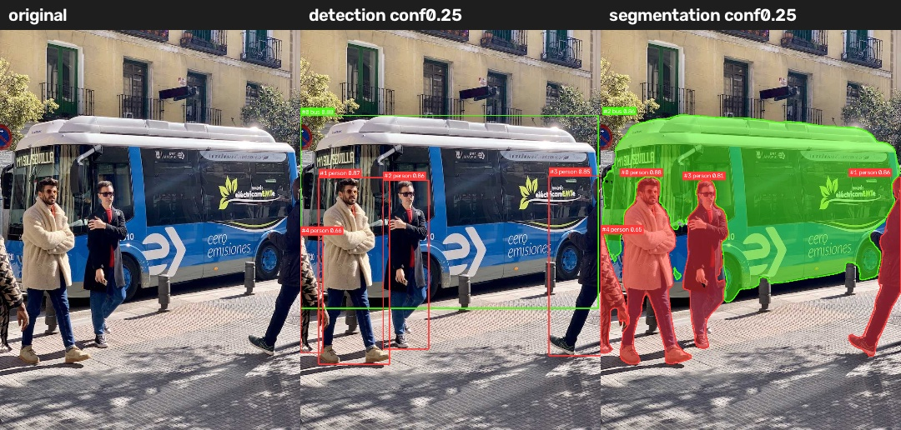
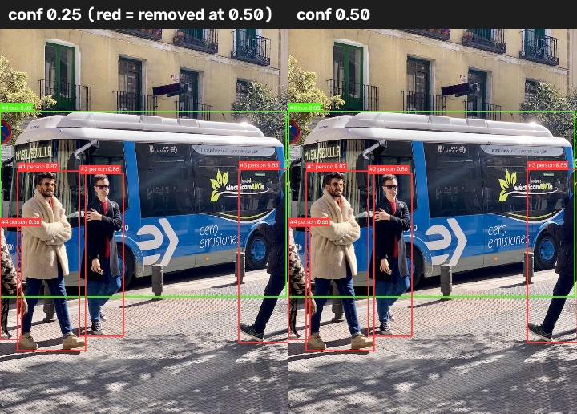
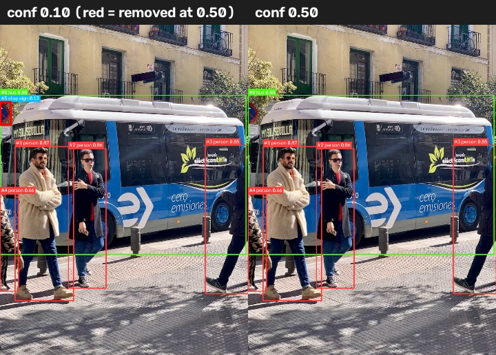
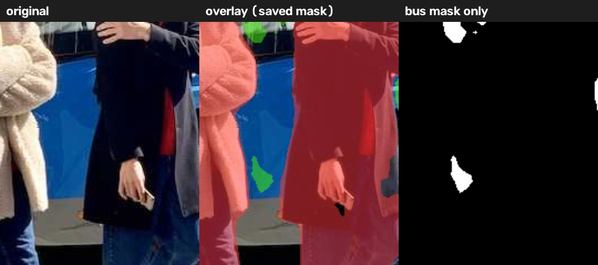
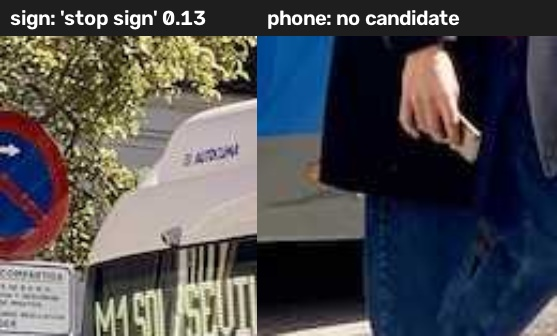

# A. 작은 YOLO 서비스 — 사진에서 "어디를 찾았는가?"

사진을 넣으면 **detection 박스**(`yolo26n.pt`)와 **segmentation 마스크**(`yolo26n-seg.pt`)를 원본 위에 겹쳐 보여 줍니다. 같은 사진을 **conf 0.25 / 0.50** 두 임계값으로 돌려서 무엇이 사라지는지 비교합니다. 결과는 그림, JSON, 마스크 파일로 저장해서 다른 프로그램에서도 다시 읽을 수 있게 했습니다.



---

## 1. 실행 위치와 환경

| 항목 | 내용 |
|---|---|
| 실행 위치 | **내 컴퓨터(로컬), CPU만 사용.** 클라우드나 외부 서버는 쓰지 않았습니다. |
| OS | Windows (개인정보 최소화를 위해 세부 버전은 기록하지 않음) |
| Python | 3.12.10 (python.org 공식 배포판, 서명 확인) — 과제 전용 가상환경 `.venv` |
| 주요 패키지 | ultralytics 8.4.210, torch 2.15.0+cpu, torchvision 0.29.2+cpu, opencv-python 5.0.0.93, numpy 2.5.4 |
| 모델 | `models/yolo26n.pt`(5.5MB), `models/yolo26n-seg.pt`(6.7MB) — Ultralytics 공식 GitHub 릴리스에서 내려받음 |
| 설정 | `imgsz=640`, `device=cpu`, `conf=0.25` 와 `0.50`, `retina_masks=True` |

정확한 버전, 파일 해시(SHA256), 실행 명령, 설정은 모두 [`outputs/yolo/manifest.json`](outputs/yolo/manifest.json)에 자동으로 기록됩니다.

## 2. 실행 방법 (처음 받은 사람 기준)

```powershell
# 1) 가상환경 만들기 + 설치 (처음 한 번)
python -m venv .venv
.venv\Scripts\python.exe -m pip install torch torchvision --index-url https://download.pytorch.org/whl/cpu
.venv\Scripts\python.exe -m pip install -r requirements.txt

# 2) 모델 내려받기 (처음 한 번, models 폴더 안에 저장됨)
cd models
..\.venv\Scripts\python.exe -c "from ultralytics import YOLO; YOLO('yolo26n.pt'); YOLO('yolo26n-seg.pt')"
cd ..

# 3) 서비스 실행 — 버스 예제 + 내 사진
.venv\Scripts\python.exe yolo_service.py --images input\bus.jpg input\my_photo.jpg

# 4) (선택) 원본 대조용 확대 그림
.venv\Scripts\python.exe make_figures.py

# 5) (선택) 노트북 화면: 사진 업로드 + 임계값 슬라이더
.venv\Scripts\python.exe -m notebook YOLO_서비스.ipynb
```

- 사진이 없으면 `[건너뜀]`을 출력하고 manifest에 `missing - 처리하지 않음`으로 남깁니다. 없는 결과를 지어내지 않습니다.
- 노트북은 내 컴퓨터 안에서만 열리는 화면입니다. 맨 아래 셀에서 **사진 올리기** 버튼과 **conf 슬라이더**를 쓸 수 있습니다.

## 3. 파일 구조

```
YOLO과제/
├─ yolo_service.py        서비스 본체 (명령줄)
├─ make_figures.py        원본 대조용 확대 그림
├─ YOLO_서비스.ipynb       노트북 화면 (실행 결과 포함)
├─ requirements.txt
├─ input/  bus.jpg, (my_photo.jpg), SOURCES.json(출처)
├─ models/ yolo26n.pt, yolo26n-seg.pt
└─ outputs/
   ├─ yolo/                     ← 과제 기본 결과 (0.25 vs 0.50)
   │  ├─ manifest.json          입력·모델·패키지 버전·실행 위치·설정
   │  ├─ code/yolo_service.py   실행한 코드 사본
   │  └─ bus/
   │     ├─ original.jpg
   │     ├─ conf0.25/ , conf0.50/
   │     │   ├─ boxes.jpg          박스 그림
   │     │   ├─ masks_overlay.jpg  마스크 반투명 겹침
   │     │   ├─ mask_label.png     마스크 파일 (픽셀값 k = result.json 의 mask_value k)
   │     │   ├─ mask_color.png     보기용 색 마스크
   │     │   ├─ panel.jpg          원본 | 박스 | 마스크
   │     │   └─ result.json        클래스·점수·좌표(xyxy), 마스크 면적
   │     ├─ compare_thresholds.json / .jpg   두 임계값 비교
   │     └─ zoom_*.jpg          원본 대조 확대 그림
   └─ yolo_explore/             ← 추가 탐색 (0.10 vs 0.50)
```

## 4. 도구와 설정을 고른 이유

- **A 과제(YOLO)를 고른 이유**: 내 컴퓨터에서 바로 돌릴 수 있습니다. 결과가 그림이라 원본과 대조하기도 쉽습니다.
- **n(nano) 모델**: 과제가 지정한 모델이고, 가장 작아서 GPU 없는 노트북 CPU로도 사진 한 장에 1초 안팎이면 됩니다.
- **CPU 전용 PyTorch**: GPU가 없으니 GPU용(수 GB) 대신 훨씬 작은 CPU판을 설치했습니다.
- **imgsz=640**: 모델이 학습된 기본 크기라 결과가 가장 안정적입니다.
- **retina_masks=True + 픽셀 마스크 그대로 저장**: 마스크를 원본 해상도에 맞춰야 원본과 1:1로 대조할 수 있습니다. 다각형으로 다시 그리던 첫 방식은 오류가 생겨서 바꿨습니다(6장 참고).
- **관찰 대상 클래스**: COCO 80개 중 거리 사진에 맞는 `person, bus, car, bicycle, motorcycle, truck, traffic light, stop sign, handbag, backpack`. JSON에는 전체 결과와 관찰 대상만 거른 결과(`watched_classes_only`)를 함께 저장합니다.

## 5. 결과 — 버스 예제 사진

### 5-1. 박스와 JSON 연결하기 (`outputs/yolo/bus/conf0.25/result.json`)

| 화면 번호 | 클래스 | 점수 | 좌표 xyxy (원본 픽셀) |
|---|---|---|---|
| #0 | bus | 0.881 | [0.0, 230.5, 803.2, 750.7] |
| #1 | person (베이지 코트) | 0.872 | [48.6, 397.7, 240.3, 902.4] |
| #2 | person (검은 코트·선글라스) | 0.861 | [222.9, 404.8, 345.5, 861.0] |
| #3 | person (오른쪽 끝) | 0.846 | [669.6, 394.5, 809.9, 879.4] |
| #4 | person (왼쪽 끝, 몸 일부만 보임) | 0.656 | [0.2, 553.0, 59.7, 871.3] |

예를 들어 #0 버스 박스는 화면 왼쪽 끝(x=0)부터 오른쪽 끝(x≈803)까지 이어집니다. 사진 속 버스가 양쪽 끝까지 꽉 찬 모습과 맞습니다.

### 5-2. 임계값 0.25 → 0.50: 무엇이 사라졌나?



- **결과: 아무것도 사라지지 않았습니다.** 두 임계값 모두 박스 5개, 마스크 5개입니다.
- **이유(JSON 근거)**: 가장 낮은 점수가 #4 person 0.656이라 0.50보다 높습니다. 0.25–0.50 사이 후보가 없습니다(`compare_thresholds.json`의 `candidates_between_thresholds: []`).
- 그래서 **추가 탐색**으로 0.10과 0.50도 비교했습니다(`outputs/yolo_explore/`).
  0.10에서는 왼쪽 위 표지판에 **`stop sign` 0.128** 박스가 생겼다가 0.50에서 사라집니다.



### 5-3. 박스 vs 마스크 — 박스 안 배경이 얼마나 빠졌나

| 객체 (seg 번호) | 마스크 면적(px) | 박스 안 마스크 비율 | 해석 |
|---|---|---|---|
| bus (#2) | 255,357 | 0.62 | 박스의 약 38%는 버스가 아님 (앞에 선 사람들, 도로) |
| person 베이지 코트 (#0) | 49,302 | 0.51 | 사람 모양이라 박스의 절반은 배경 |
| person 검은 코트 (#3) | 33,361 | 0.60 | |
| person 오른쪽 끝 (#1) | 21,311 | 0.31 | 몸이 사진 끝에서 잘리고 어두워 마스크가 작음 |
| person 왼쪽 끝 (#4) | 11,065 | 0.47 | |

※ seg 모델과 det 모델은 서로 다른 모델이라 **번호 순서가 다릅니다.** 같은 대상인지는 좌표로 맞췄습니다.

저장한 `mask_label.png`를 다시 열어 픽셀을 세면 JSON 면적과 **5개 모두 정확히 같습니다**(노트북 3번 셀). 화면의 색칠과 저장 파일이 같은 결과라는 뜻입니다.

## 6. 원본 대조 기록 (실제로 짚은 곳)

| # | 위치 (원본 픽셀) | 무엇을 봤나 | 판정 | 근거 그림 |
|---|---|---|---|---|
| 1 | 두 남자 사이로 보이는 버스 옆면, 대략 x 150–330, y 520–740 | 파란 버스 차체가 분명히 보이는데 **버스 마스크에 작은 조각 하나만 들어가고 대부분 빠짐** | **놓친 부분 (마스크 누락)** | `zoom_between_people.jpg` |
| 2 | 검은 코트 남자 손, 대략 x 265–295, y 665–705 | 손에 든 **휴대폰**. COCO에 `cell phone` 클래스가 있지만 conf 0.01까지 낮춰도 후보가 없음 | **놓친 대상** | `zoom_missed.jpg` (오른쪽) |
| 3 | 왼쪽 위 표지판, [0, 252, 35, 326] | 모델은 `stop sign` 0.13으로 봤지만, 원본을 확대하니 **파란 바탕에 빨간 사선인 주차금지 표지판**임. 정지 표지판이 아님 | **오탐 후보** — 0.25·0.50 모두에서 걸러진 것이 옳았음 | `zoom_missed.jpg` (왼쪽) |
| 4 | 오른쪽 끝 사람 발 근처 [669, 822, 808, 881] | conf 0.01에서 `skateboard` 0.07 후보. 원본에는 스케이트보드 없음(신발·그림자) | 오탐 후보 — 임계값으로 걸러짐 | conf 0.01 탐색 출력 |
| 5 | 버스 박스 아래쪽 y≈750 | 박스가 앞의 사람 다리·도로까지 포함함 | 박스 특성(배경 포함). 마스크 비율 0.62로 확인 | `panel.jpg` |




### 수정 내역 (내 코드의 오류를 원본 대조로 찾아 고친 것)

| 언제 | 원래 결과 | 원본 대조에서 본 것 | 수정 | 수정 후 |
|---|---|---|---|---|
| 첫 실행 | 버스 마스크 면적 255,686px. 두 남자 사이에 **1픽셀 굵기의 초록 선**이 지나감 | 원본에서 그 자리는 사람 코트라 버스가 아님 | 원인: 조각난 마스크를 다각형(`masks.xy`) 하나로 이어 칠하면서 조각 사이에 선이 생김. → 모델의 픽셀 마스크(`masks.data`)를 그대로 저장하도록 변경 | 면적 255,357px (−329px). 선 사라짐. 대조 기록 #1의 "버스 옆면 누락"은 수정 후에도 남음 → 모델 자체의 한계로 판단 |

## 7. 처리 범위와 확인 필요 (정직하게)

- ✅ **처리 완료**: 버스 예제 사진 1장. conf 0.25 / 0.50 결과, JSON, 마스크, manifest 저장. 0.10 탐색 실행.
- ⏳ **이번 제출에서 처리하지 않음 — 내 사진**: 개인정보 보호를 위해 이번에는 자기 사진을 넣지 않고 **버스 예제 사진만으로 제출**하기로 했습니다. 그래서 `input/my_photo.jpg`가 없습니다. 실행 기록(manifest)에도 `missing - 처리하지 않음`으로 남아 있습니다. 따라서 "다른 사진에서도 같은 방식으로 동작하는지"는 **이번 결과로 확인하지 못했습니다.** 다만 노트북 5번 셀의 업로드 화면과 `--images` 옵션은 어떤 사진이든 받도록 만들었습니다. 공유 동의를 받은 사진을 `input/my_photo.jpg`로 넣고 같은 명령을 다시 실행하면 똑같은 형식으로 결과가 생깁니다.
- ❓ **확인 필요**
  - 대조 기록 #2의 휴대폰 좌표는 확대 그림에서 계산한 범위입니다. 그 범위를 잘라 보니 손가락과 휴대폰 모서리가 보였습니다. 다만 휴대폰의 정확한 외곽 좌표(정답 박스)는 직접 그리지 않았습니다.
  - 오른쪽 끝 사람(#1 seg)의 마스크 비율이 0.31로 낮은 원인은 "몸이 잘리고 어두워서"라고 추정합니다. 아직 픽셀 단위로 확인하지 않았습니다.
  - 사진 1장만으로는 "임계값을 올리면 무엇이 사라지는가"를 일반화할 수 없습니다. 이 사진은 점수가 모두 높아서 0.25 → 0.50 사이에 차이가 없었습니다.

## 8. 처음 예상과 실제 결과

| 처음 예상 | 실제 |
|---|---|
| 0.50으로 올리면 작게 보이는 사람(왼쪽 끝)이 사라질 것 | **사라지지 않음.** 그 사람도 0.656점이었음. 사라지는 것을 보려면 0.10 수준까지 내려야 했음 |
| 마스크는 박스보다 정확하니 오류가 적을 것 | 박스는 다 맞았지만 **마스크는 사람 사이로 보이는 버스 조각을 놓침** — 가려진 물체의 "틈"에 약함 |
| 오류는 모델에서만 나올 것 | **내 코드(다각형 변환)에서도 오류가 생겼고**, 원본을 확대해 보고서야 발견함 |

## 9. 입력 자료 출처와 라이선스

- `input/bus.jpg`: Ultralytics 공식 예제 이미지(ultralytics 패키지의 `assets/bus.jpg`). 출처는 `input/SOURCES.json`에 적었습니다.
- 내 사진: **공유에 동의한 사진만** 쓰고, 출처와 공유 조건을 `input/SOURCES.json`에 적습니다. 다른 사람 얼굴이 나오면 동의를 받거나 다른 사진을 고릅니다.
- Ultralytics YOLO는 **AGPL-3.0** 라이선스입니다. 과제·학습용으로는 괜찮습니다. 이 서비스를 인터넷에 공개 배포하려면 소스 공개 의무(AGPL)를 지키거나 Enterprise 라이선스가 필요합니다.
